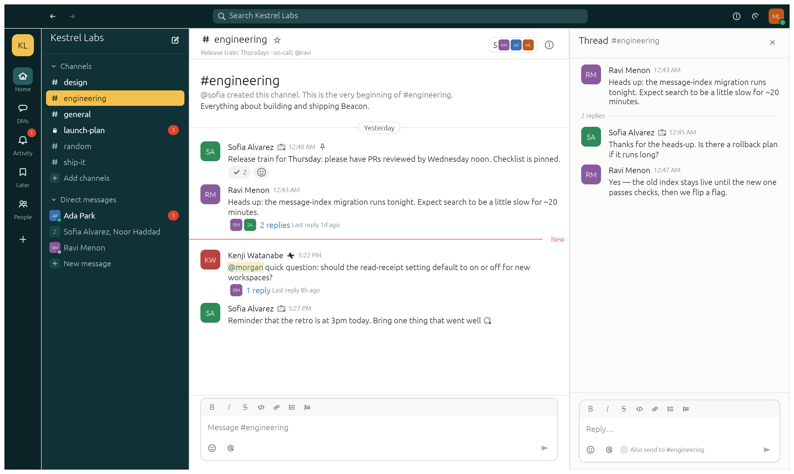
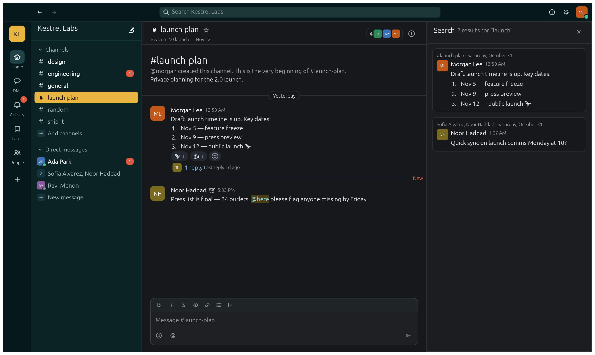

<h1 align="center">ChatCraft</h1>

<p align="center">
  <b>Team chat you own: an open-source, self-hostable workspace messenger, built in pure Rust.</b>
</p>

<p align="center">
  Channels, direct and group messages, threads, reactions, mentions, search, status and presence —
  the workflow people know from Slack and Microsoft Teams, in one fast native app for macOS,
  Windows, Linux and BSD, and in the browser via WebAssembly. Run your own server with one binary.
</p>

<p align="center">
  
  
  
  
</p>

<p align="center">
  
</p>

> **Status: early (M0 — foundations).** Everything shown works end to end, in-process and over a real
> server, but ChatCraft is not yet ready to replace your team's chat. See [ROADMAP.md](ROADMAP.md).

## Why ChatCraft

- **Familiar.** Sidebar with channels and DMs, unread and mention badges, threads in a side pane,
  hover actions, emoji reactions, `*bold*` / `_italic_` / `` `code` `` formatting, `@mentions`,
  `#channel` links, Enter to send, Up to edit your last message, Ctrl/Cmd+K to jump anywhere.
- **Yours.** One `chatcraft-server` binary, an append-only journal on disk, no database to run, no
  telemetry. Or no server at all: the demo workspace runs entirely in-process.
- **Fast and native.** One Rust codebase, GPU-rendered with [egui](https://github.com/emilk/egui).
  No Electron.
- **Built for agents.** Every action is a command with an id. The same commands drive the UI,
  keyboard shortcuts, a command-line tool and an MCP server.
- **Safe by construction.** No `unsafe`, no panics in production code, hostile-input tests on every
  command, private conversations filtered at the server.
- **Open.** MIT OR Apache-2.0. Clean-room: built from observation and public documentation, with
  every asset original.

## What works today

| Area | Highlights |
|---|---|
| **Conversations** | Public and private channels, direct and group messages, notes-to-self; create, browse, join, leave, invite, remove, rename, topic, description, archive, star, mute |
| **Messages** | Send, edit (inline or Up arrow), delete, pin, save for later, copy link; drafts per conversation; jumbo emoji |
| **Formatting** | Bold, italic, strike, inline code, code blocks, quotes, bulleted and numbered lists, links, `@person`, `@here`/`@channel`, `#channel`, `:emoji:` with autocomplete |
| **Threads** | Reply in thread, also-send-to-channel, reply counts, repliers, last reply time |
| **Reactions** | Quick reactions, emoji picker, toggle, who-reacted tooltips |
| **Reading** | Unread and mention counts, "New" divider, mark read / mark all read, next-unread navigation, back/forward |
| **Search** | Words, `"phrases"`, `-exclusions`, `in:` `from:` `to:` `has:link` `has:reaction` `has:pin` `is:thread` `is:saved` `before:` `after:` `on:` |
| **People** | Profiles and titles, presence (active, away, do not disturb), custom status with emoji and expiry, people directory |
| **Look** | Light and dark themes, code-drawn icon set, keyboard shortcuts dialog, toasts for mentions |
| **Server** | WebSocket server, durable journal, join token, reconnecting clients that resync themselves |
| **Agents** | `chatcraft-cli run`, `chatcraft-cli mcp`, 65 engine commands (plus 9 UI commands), parity report |

Parity with Slack and Teams is measured, not guessed: **64 of 113** catalogued features have a
command today ([docs/parity-checklist.md](docs/parity-checklist.md)).

<p align="center">
  
</p>

## Quick start

```sh
# The desktop app with the built-in demo workspace (nothing leaves your machine)
cargo run --release -p chatcraft

# Host a workspace, then join it from two terminals
cargo run --release -p chatcraft-server -- --data ./chatcraft-data --name "My Team"
cargo run --release -p chatcraft -- --server ws://127.0.0.1:7900 --handle ada --token <TOKEN>
cargo run --release -p chatcraft -- --server ws://127.0.0.1:7900 --handle bo  --token <TOKEN> --dark

# In the browser (demo workspace)
cd apps/chatcraft-web && trunk serve
```

The server binds to `127.0.0.1` and speaks `ws://`; put it behind a TLS reverse proxy before
exposing it (see [SECURITY.md](SECURITY.md)).

## For agents: CLI and MCP

```sh
chatcraft-cli commands                                   # every command, with params
chatcraft-cli run --demo --as ada \
  --cmd 'message.send={"channel":"#general","text":"Standup in 5 :coffee:"}' \
  --cmd 'search.messages={"query":"launch from:@noor"}'
chatcraft-cli mcp --server ws://127.0.0.1:7900 --as helper-bot --token <TOKEN>
```

See [docs/mcp.md](docs/mcp.md).

## Architecture

A strict layer cake (enforced by `cargo xtask layers`): `core`/`text` → `model` (event-sourced
state) → `proto`/`store`/`search` → `hub` (the authority, pure) → `engine` (client session +
command registry) → `net`/`mcp` → `ui-egui` → apps. The same hub runs inside the server and
in-process, so the demo, the tests and production share one code path.
Details: [docs/architecture.md](docs/architecture.md), wire format: [docs/protocol.md](docs/protocol.md).

## Roadmap

[ROADMAP.md](ROADMAP.md) has the stage and progress log; [docs/gaps.md](docs/gaps.md) is the ranked
work list (files, per-user auth, TLS, notifications, calls…).

## Contributing

`cargo xtask ci` must pass (fmt, clippy `-D warnings`, tests, assets, layers, wasm). Read
[AGENTS.md](AGENTS.md) first — especially the clean-room and asset rules — and
[docs/contributing.md](docs/contributing.md).

ChatCraft follows the conventions of the ArtCraft Crafting apps (WordCraft, PdfCraft, GridCraft,
PhotoCraft…) but is an independent project.

## License and credits

MIT OR Apache-2.0, at your option. ChatCraft is not affiliated with Slack, Salesforce or Microsoft;
their names are used only to describe feature parity. Third-party material: [NOTICE](NOTICE) and
[ATTRIBUTION.md](ATTRIBUTION.md).
